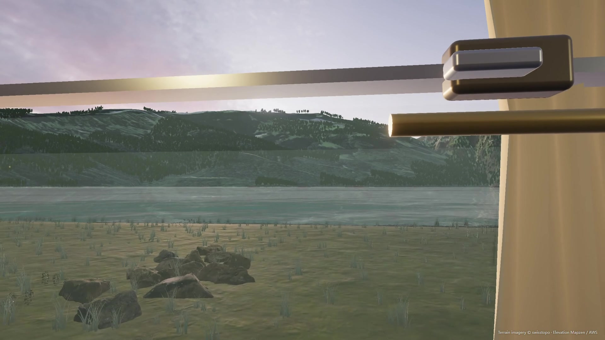

# 晚点之前 · The Hours Between

一段从榆川到白鹭湾的第一人称绿皮火车旅程，使用 Three.js 制作。



公开演示视频：《沉浸式坐车》。游戏代码使用 MIT 许可，第三方素材许可和署名见 [ASSETS.md](ASSETS.md)。

需要 Node.js 20.19+ / 22+、支持 WebGL 2 且已启用硬件加速的桌面浏览器。首次从 GitHub 下载后运行：

```sh
npm ci
npm run build
npm run preview
```

打开 <http://127.0.0.1:5190/>。构建后在 Windows 上也可以双击 **启动旅程.cmd**。所有游戏资源随仓库提供，约 242 MB；首次安装依赖需要联网，构建后的游戏运行时无需联网。仓库不包含 node_modules 与 dist。

## 操作

| 操作 | 按键 |
|---|---|
| 走动 | WASD / 方向键 |
| 环顾 | 点击画面锁定鼠标，或按住左键拖动 |
| 上车、坐下、起身、交谈、下车 | 走近后 E，或点击互动提示 |
| 靠近窗户 / 靠回座椅 | 坐下后 F |
| 推开 / 关闭上半扇车窗 | O |
| 车票 | J |
| 保存 PNG 照片 | P |
| 隐藏界面 | H |
| 暂停与设置 | Esc / 右上角按钮 |

上车约十秒后发车。正常旅程约八分钟，可在设置中加速。到站后起身，沿过道走回车门并下车。可以调整晃动强度、雨天、声音和画质。

## 此次风景重构

- 用真实阿尔卑斯高程生成连续山体，并将 SWISSIMAGE 航拍影像与高程坐标对齐，保留真实的裸岩、林带与山脊分布。
- 近景采用 Poly Haven 岩壁、花岗岩、岸线、苔石、树木和植物模型；保留物体视差，按距离切换简化模型。
- 中远景使用实例化树林；最远树林使用实际树模型的官方透明渲染图。地形与植被均为连续三维世界的一部分。
- 水面实时反射场景，使用波纹法线；可见天空来自实拍 HDR，光照与雾色随旅程变化。
- 路线区分河谷草甸、江桥、杉林与峡谷、隧道、开阔湖面，减少沿途重复。

列车颠簸、轮轨节拍、桥梁和隧道声效与行车位置同步；车内包含活动窗玻璃、风扇、窗帘、茶水、蒸汽与尘粒。邻座有简短交谈。

## 车内精修

- 窗胶条、锁扣、螺丝、窗台、顶棚接缝与通风槽；风扇的固定护网与独立转子。
- 座椅包边、缝线、头枕布、脚踏、金属丝废纸篮、衣帽钩和帆布行李袋。
- 空心搪瓷杯、茶水和柔和蒸汽、暖水瓶、玻璃杯、折叠布、实体书和弯曲报纸。
- 两位自行建模的乘客，补充五官、头发、衣领、袖口、手指和鞋；有眨眼与轻微身体动作。
- 互动提示改为左下角的透明小字；坐下后的“起身”提示约 4.5 秒后淡出。E 键始终有效，H 可隐藏整个 HUD。

## 真实性的范围

这是使用真实地形与资产重新编排的虚构旅程，并非复现某条现实铁路。近景模型和材质已有实景依据；列车、车站与人物仍由项目自行建模，人物较简化。远树使用贴片，地形影像存在航拍光照；悬挂为乘坐感近似，声音以 Web Audio 合成为主。当前画面仍有可打磨的空间，不应视作照片级或最终商业美术版本。

地形影像 **© swisstopo**；高程 Mapzen / AWS Open Data；模型与表面素材主要来自 Poly Haven CC0。完整来源见 [ASSETS.md](ASSETS.md)，实测记录见 [VERIFICATION.md](VERIFICATION.md)。

## 开发

npm install、npm run dev（5188）、npm test、npm run build。node serve.mjs 提供成品服务（5190）。追加 ?qa=1 显示场景跳转和状态读数，正常入口隐藏这些工具。

工具脚本位于 tools/，包含模型优化、DEM 与航拍拼接、地表材质与远树图集生成。它们为可选的资产处理工具，运行游戏无需重新下载或处理模型。

## 实机录制

追加 `?film=1` 显示录制面板。先录制 10 秒测试，再录制完整镜头游览。它使用同一个实时游戏场景和 Web Audio 主混音，导出 1920×1080、30fps 的 WebM；不录麦克风、桌面或其他浏览器标签。正常游戏入口不显示此面板。录制期间保持页面可见，不切换标签；外部编码器可将结果转为 H.264/AAC MP4。

录像包含镜头跳转、短暂淡入淡出和地形来源署名，没有讲解、字幕或另加配乐。广播使用系统语音时不属于 Web Audio 混音，因此不保证录入视频。
